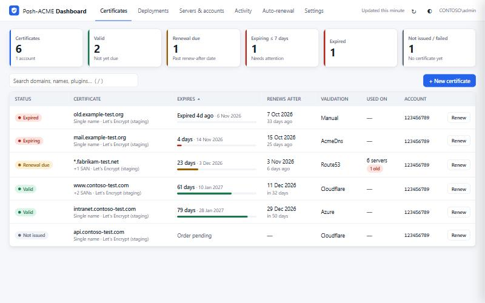

# Posh-ACME Dashboard

A web dashboard for [Posh-ACME](https://poshac.me) that shows the status of every managed certificate and lets you renew, revoke, delete and request certificates from the browser.

**Website:** <https://zoutbot-cpu.github.io/posh-acme-dashboard/>



It's PowerShell plus static HTML/JS. It needs no extra modules, no Node and no internet CDN.

> **Project status: early.** Tested against sample data, Let's Encrypt staging and local test servers. Issuing through GoDaddy, sending through Microsoft 365, and the installer's admin-only steps have not yet been run end to end. Start with `-ReadOnly` and a staging server.

This is an independent project, not affiliated with Posh-ACME, Let's Encrypt, GoDaddy or Microsoft.

## Features

- **Overview**: counts of valid, renewal-due, expiring (≤ 7 days), expired and not-issued certificates. Click a count to filter the table.
- **Certificate table**: lists every order across all ACME servers and accounts, with lifetime bars, renew-after dates and the validation plugin. You can search and sort it.
- **Detail panel**: shows SANs, issuer, thumbprint, serial, validity, order settings and the folder path. You can download `cert` / `chain` / `fullchain` PEM files. Private keys and PFX files are never served.
- **Actions** run in the background with a live log:
  - Renew (with or without force)
  - Renew all due orders for an account
  - Revoke
  - Delete an order (optionally revoking it first)
  - Change the validation plugin and credentials
  - Request a new certificate (the plugin parameter form is built from the plugin's own metadata)
  - Create an ACME account
- **Auto-renewal tab**: finds scheduled tasks that run `Submit-Renewal` and shows their last result and next run. It warns when there are none and gives you a ready-made command to create one.
- Light and dark themes.

## Templates (GoDaddy)

The **New certificate** form opens with the **GoDaddy DNS** template selected. It pre-selects the `GoDaddy` plugin, its `Secure` parameter set (`GDKey` + `GDSecretSecure`) and a 180-second DNS sleep, and shows GoDaddy-specific tips.

**Reusing credentials.** When an order on the same ACME server already uses GoDaddy, the form offers **Reuse saved credentials from <order>** under *Credentials*. The background job reads that order's encrypted plugin args with `Get-PAPluginArgs` and copies them to the new order, so the GoDaddy secret is entered once and never sent back to the browser. Anything you type into a field overrides just that value, for example a different `GDCustomerId`. The *Validation settings* dialog has the same option. Use it to switch an existing order to GoDaddy, or to update credentials on several orders after rotating the key once.

First GoDaddy certificate:
1. Create a **Production** API key at <https://developer.godaddy.com/keys>.
2. Click **New certificate**, enter the domains (wildcards like `*.example.com` work), pick *Enter new credentials*, and fill in `GDKey` and `GDSecretSecure`.
3. Watch the log on the Activity tab. Later certificates can reuse these credentials.

**Test credentials.** Before requesting, click **Test credentials** in the Validation section. It works with typed or reused credentials, in both the New certificate and Validation settings dialogs. For each domain it does what the GoDaddy plugin does, but read-only: it finds the domain's DNS zone in the GoDaddy account and reads its TXT records. No records are created or changed, nothing is saved, and no ACME request is made. It reports per domain:
- ✓ zone found and records readable
- ✗ 401: wrong key/secret, or an OTE key used against production
- ✗ 403: the GoDaddy account isn't allowed to use the API, or `GDCustomerId` is wrong
- ✗ no zone: the domain isn't in that GoDaddy account or doesn't use GoDaddy DNS

Each test also appears on the Activity tab.

GoDaddy only allows DNS API access for some account types. If validation fails with `ACCESS_DENIED` or 403, the GoDaddy account isn't allowed to use the API, and the key itself is fine.

### Customising templates

Templates live in `templates.json` next to the script. The file is re-read on every request, so there's no need to restart. Each entry can set:

| Field | Meaning |
| --- | --- |
| `id`, `name`, `description` | Identifier and display text |
| `default` | `true` selects this template when the form opens |
| `plugin`, `parameterSet` | Posh-ACME plugin and parameter set |
| `pluginArgs` | Non-secret defaults, e.g. `"GDCustomerId": "123"`. Secret fields are never prefilled. |
| `serverUrl` | `LE_PROD`, `LE_STAGE`, another well-known name, or a directory URL. `null` keeps the current server. |
| `certKeyLength`, `dnsSleep`, `validationTimeout`, `lifetimeDays`, `preferredChain`, `install`, `alwaysNewKey` | Order defaults |
| `notes`, `links` | Tips and `{ "label", "url" }` links shown in the form |

## Deployments: where certificates are used

Posh-ACME knows when a certificate renews, but not where it's installed. A wildcard certificate typically ends up on several IIS servers, load balancers, Exchange, firewalls and appliances. The **Deployments** tab keeps that list and checks each entry.

- **Register** each place a certificate is installed, either from a certificate's detail panel (**+ Add server**) or from the Deployments tab. Each entry has:
  - host and port;
  - an optional SNI name, needed when the host is an IP address or serves several certificates;
  - a check method;
  - type, owner and notes, for example how to install the certificate there.
- **Live check.** The dashboard connects to each `host:port`, reads the certificate the server presents, and disconnects. This is read-only and needs no credentials on the target. Check methods:
  - **TLS**: HTTPS, LDAPS, IMAPS, and anything else that starts with TLS.
  - **SMTP with STARTTLS**: Exchange and mail relays on port 25/587.
  - **Don't check**: keeps the entry as documentation only, for devices that only store the certificate.
- **Status** is computed against the order's *current* certificate:

  | Status | Meaning |
  | --- | --- |
  | Up to date | The server presents the current certificate |
  | **Old certificate** | Same names but an older certificate: the server wasn't updated after a renewal |
  | **Wrong certificate** | The server presents a different certificate |
  | Unreachable | Connection or TLS handshake failed (the error is shown) |

  Because the comparison happens when the page is read, a renewal immediately turns servers that still have the previous certificate into **Old certificate**, without waiting for a re-check.
- **When checks run:**
  - every 6 hours (*Settings → Server checks*, 0 = manual only);
  - when an entry is added or its endpoint changes;
  - when you click **Check**.

  Checks run in parallel in a background process with a 6-second timeout per server.
- The certificate table's **Used on** column shows how many servers each certificate is on, and how many are outdated.
- **Email**: expiry warnings also list servers with an old certificate once a grace period after the renewal has passed (default 24 hours, giving you time to install it), plus servers with the wrong certificate. The digest lists every server that isn't up to date. `-NotifyOnce` runs a due server check before deciding what to send.

Entries are stored in `deployments.json` next to the script. Anyone with write access can add entries, which makes the dashboard host connect to that host and port, so keep write access limited.

## Email notifications (Microsoft 365)

The **Settings** tab configures email through Microsoft Graph. It signs in as an Entra ID app registration using OAuth 2.0 client credentials, so no SMTP password and no user sign-in are needed. Only users with write access see the tab.

- **Expiry warnings.** Checked every 15 minutes. One email lists every certificate that is:
  - expired;
  - expiring within *N* days (default 14);
  - more than *N* days past its renew-after date (default 3), which usually means the renewal task is failing;
  - optionally, a failed order.

  Each problem is reported once, then again every reminder interval (default 24 h) until it's fixed.
- **Digest.** A daily or weekly summary of all certificates, at a time you choose (server local time).
- **Test and send now.** *Send test email* uses the values in the form without saving them. *Send alert now* and *Send digest now* use the saved settings.
- **Staging servers** are ignored by default.

### App registration

1. Entra admin center → **App registrations → New registration**: single tenant, no redirect URI.
2. **API permissions → Microsoft Graph → Application permissions → `Mail.Send`**, then **Grant admin consent**.
3. **Certificates & secrets**: upload a certificate (recommended) or create a client secret.
   - Certificate: create it as the dashboard's Windows user. The Settings tab shows a `New-SelfSignedCertificate` snippet. Upload the `.cer` and enter the thumbprint.
   - Secret: paste its *Value*. It's stored in `settings.json`, encrypted with Windows DPAPI for the dashboard user, and never sent back to the browser.
4. Sender: a shared mailbox, for example `pki-alerts@contoso.com`.
5. **Restrict the app.** `Mail.Send` as an application permission can send as *any* mailbox. Limit it to the sender with Exchange Online RBAC for Applications or an application access policy. The Settings tab has an example.

Sign-in and send errors are translated into a likely cause, for example "AADSTS7000215 → the client secret is wrong or expired" or "403 → Mail.Send not consented".

### Sending when the dashboard isn't running

The dashboard sends email while it runs. To send even when it's stopped, add an hourly scheduled task, running as the same Windows user:

```powershell
pwsh.exe -NoProfile -File C:\path\to\Start-PoshAcmeDashboard.ps1 -NotifyOnce
```

The task exits with code 1 when sending fails, so failures show up in Task Scheduler. A lock stops the task and a running dashboard from sending the same email twice. After a failure, the dashboard waits 15 minutes before retrying.

`settings.json` and `notify-state.json` are created next to the script. Don't copy `settings.json` to another machine or user: the DPAPI-encrypted secret can only be decrypted by the account that saved it.

## Requirements

- Windows with PowerShell 7+ (recommended) or Windows PowerShell 5.1
- Posh-ACME 4.x: `Install-Module Posh-ACME -Scope CurrentUser`
- Git, to download the dashboard: `winget install --id Git.Git -e --source winget`, then open a new PowerShell window. Without winget or Git, download the [ZIP](https://github.com/zoutbot-cpu/posh-acme-dashboard/archive/refs/heads/main.zip), run `Unblock-File` on it, and extract it.

## Running

Run the dashboard **as the same Windows user that owns your Posh-ACME config** (normally the account your renewal task runs as). Posh-ACME stores its data per user in `%LOCALAPPDATA%\Posh-ACME`, or in `$env:POSHACME_HOME` if that is set.

```powershell
.\Start-PoshAcmeDashboard.ps1 -OpenBrowser
```

Then browse to <http://localhost:8580>. Press Ctrl+C to stop it.

### Installing it to start at boot

`Install-PoshAcmeDashboard.ps1` sets up one shared instance. Run it from an **elevated** prompt, in the PowerShell edition the dashboard should use (`pwsh` for 7, `powershell` for 5.1). Add `-WhatIf` first to see every step without changing anything.

```powershell
# This machine only, as the current user
.\Install-PoshAcmeDashboard.ps1

# Shared with the team over HTTPS, with daily renewal
.\Install-PoshAcmeDashboard.ps1 -ServiceAccount 'CONTOSO\svc-acme' -ListenAddress + `
    -AllowedPrincipals 'CONTOSO\PKI Admins' -ReadOnlyPrincipals 'CONTOSO\Helpdesk' `
    -CertThumbprint <thumbprint> -CreateRenewalTask
```

It does the following:
- copies the program to `C:\Program Files\PoshAcmeDashboard`;
- installs Posh-ACME for all users if needed;
- creates `C:\ProgramData\PoshAcmeDashboard` for settings, the deployment list and logs (`logs\dashboard.log`), writable only by the run account and administrators;
- registers a scheduled task, `Posh-ACME Dashboard`, that starts at boot and restarts on failure.

When shared, it also adds the URL reservation, the HTTPS binding and a firewall rule for domain and private networks. Account and group names are checked before anything changes.

Step-by-step help for creating the service account (gMSA or domain user) and getting the HTTPS certificate for `-CertThumbprint` (internal CA, Posh-ACME or self-signed) is on the [website's Install section](https://zoutbot-cpu.github.io/posh-acme-dashboard/#service-account). `-CertThumbprint` is optional; without it the dashboard uses plain HTTP.

**Choose the run account carefully.** Posh-ACME stores its config and encrypted credentials per Windows account, so install under the account that already owns your certificates, or they won't appear. A group Managed Service Account (name ending in `$`) needs no password. The account must be allowed to "Log on as a batch job".

Run the script again to upgrade; data and an edited `templates.json` are kept. Stopping or upgrading ends the task immediately, so don't do it while a renewal is running.

### Updating

To update an installed dashboard to the latest version on GitHub without copying files over by hand, paste this into an **elevated** PowerShell on the server. It downloads `main`, replaces the program files and restarts the task. Settings, the deployment list, logs and your `templates.json` are kept, and the install settings (account, port, HTTPS, principals) stay as they are.

```powershell
$dst = "$env:ProgramFiles\PoshAcmeDashboard"; $zip = "$env:TEMP\posh-acme-dashboard.zip"; $tmp = "$env:TEMP\posh-acme-dashboard"
Invoke-WebRequest 'https://github.com/zoutbot-cpu/posh-acme-dashboard/archive/refs/heads/main.zip' -OutFile $zip -UseBasicParsing
Remove-Item $tmp -Recurse -Force -ErrorAction SilentlyContinue; Expand-Archive $zip $tmp; $src = "$tmp\posh-acme-dashboard-main"
Stop-ScheduledTask 'Posh-ACME Dashboard'
Copy-Item "$src\Start-PoshAcmeDashboard.ps1", "$src\Install-PoshAcmeDashboard.ps1", "$src\README.md" $dst -Force
'lib', 'www' | ForEach-Object { Remove-Item "$dst\$_" -Recurse -Force -ErrorAction SilentlyContinue; Copy-Item "$src\$_" $dst -Recurse -Force }
Start-ScheduledTask 'Posh-ACME Dashboard'; Remove-Item $zip, $tmp -Recurse -Force
```

If you installed with a custom `-InstallPath`, change `$dst` on the first line. Like an upgrade, this ends the running task, so don't do it while a renewal is running. Running the installer again is only needed when you want to change install settings.

```powershell
.\Install-PoshAcmeDashboard.ps1 -Uninstall              # keeps settings and the deployment list
.\Install-PoshAcmeDashboard.ps1 -Uninstall -RemoveData  # deletes those too
```

Uninstalling never touches Posh-ACME, its config or your certificates.

### Sharing with your team

By default the dashboard only listens on `localhost` with no login. To let colleagues use it, listen on all addresses with Windows authentication:

```powershell
# one-time, elevated: allow your user to listen on the port
netsh http add urlacl url=http://+:8580/ user="CONTOSO\svc-acme"

.\Start-PoshAcmeDashboard.ps1 -ListenAddress + -AllowedPrincipals 'CONTOSO\PKI Admins' -ReadOnlyPrincipals 'CONTOSO\Helpdesk'
```

- `-Authentication Windows` is the default for non-localhost bindings. Browsers sign in with Kerberos or NTLM.
- `-AllowedPrincipals`: the users or groups allowed in. **Required** when listening on the network. Without it the dashboard refuses to start, rather than letting every domain user in.
- `-AllowAnyUser`: skips that check, also when authentication is off. Only use it when access is already limited elsewhere, such as a firewall rule or an authenticating reverse proxy.
- `-ReadOnlyPrincipals`: these users can view the dashboard but not run actions.
- `-ReadOnly`: locks the whole dashboard down for everyone. See [Read-only mode](#read-only-mode).
- Open the port in Windows Firewall if needed.

For HTTPS, bind a certificate to the port (you can use one issued by Posh-ACME itself) and add `-UseHttps`:

```powershell
netsh http add urlacl url=https://+:8443/ user="CONTOSO\svc-acme"
netsh http add sslcert ipport=0.0.0.0:8443 certhash=<thumbprint> appid="{6b7d3c1e-2f1a-4f7e-9a51-0c6a3e7d9b21}"
.\Start-PoshAcmeDashboard.ps1 -ListenAddress + -Port 8443 -UseHttps
```

To keep it running permanently, register it as a scheduled task that starts at boot, or wrap it with a service manager such as NSSM. Run it as the Posh-ACME user.

## Read-only mode

```powershell
.\Start-PoshAcmeDashboard.ps1 -ReadOnly -OpenBrowser
```

Use this to look around, or to try real GoDaddy credentials, with no risk of changes.

| Normally | With `-ReadOnly` |
| --- | --- |
| Renew, revoke, delete, new certificate or account, change plugin | Refused |
| Settings and Deployments edits | Refused |
| Expiry alerts and digest emails | Not sent; the timer doesn't run |
| Automatic and manual server checks | Don't run |
| Loading Posh-ACME (contacts the ACME server, rewrites `dir.json`) | The module only sees an empty temporary folder; your config is read with plain file reads |
| Reusing saved GoDaddy credentials | Refused; decrypting them means switching Posh-ACME's current account |

The one action left is **Test GoDaddy credentials**, on the banner at the top of the page. For each domain it sends two `GET` requests to `api.godaddy.com`: one for the zone's `NS` records and one for its `_acme-challenge` TXT records (a parent zone may take a few more `GET`s to find). It never sends `PUT`, `POST`, `PATCH` or `DELETE`. Values typed into the form aren't written to disk or to the log; only the first four characters of the key are logged.

The restriction is enforced in the web server (one allow-list in front of every route) and again in the background process, not only by hiding buttons. `-ReadOnly` can't be combined with `-NotifyOnce`.

**Using a company GoDaddy account:** the dashboard takes an API key and secret from [developer.godaddy.com/keys](https://developer.godaddy.com/keys), never a GoDaddy username or password. Read-only mode limits what the *dashboard* does with the key; the key itself isn't restricted. Create a separate key for the test, and delete it at GoDaddy afterwards. Keep the dashboard on `localhost`, or use HTTPS, so the secret doesn't cross the network in clear text. Stop the dashboard when you're done, since the background job stays in memory until then.

## How it works

- **Reading never changes state.** The dashboard reads Posh-ACME's config folder directly: `dir.json`, `acct.json`, `order.json` and `cert.cer`. It never calls `Set-PAServer` or `Set-PAAccount` just to display data, so the "current" server and account that your scheduled `Submit-Renewal` relies on stay untouched. Account private keys and PFX passwords are never sent to the browser.
- **Actions run as background jobs** in a separate PowerShell process, with `$VerbosePreference = 'Continue'` so you see Posh-ACME's progress. A job selects the server and account it needs, runs the cmdlet, and then **restores the previous current-server, current-account and current-order selection**. A named mutex makes dashboard actions run one at a time.
- **Plugin secrets** you enter are sent once to the job, converted to `SecureString`, and saved by Posh-ACME using its normal encrypted plugin-args storage. They are never written to logs or shown again.
- **The Manual DNS plugin** isn't offered, because it needs someone at a console. Orders that already use it are flagged, since they can't renew unattended.

## Security notes

- POST requests require an `X-Requested-With` header, which protects against cross-site requests. A strict Content-Security-Policy is set on the page.
- Anyone with write access can revoke or delete certificates and request new ones with your ACME accounts. Restrict access with `-AllowedPrincipals` or `-ReadOnlyPrincipals`.
- Without HTTPS, plugin credentials typed into the New certificate or Validation settings forms cross the network in clear text. Use `-UseHttps` whenever the dashboard is reachable from other machines.

## Files

| Path | Purpose |
| --- | --- |
| `Start-PoshAcmeDashboard.ps1` | Web server, JSON API and background action runner |
| `Install-PoshAcmeDashboard.ps1` | Installs, upgrades or removes the dashboard as a startup task |
| `templates.json` | New-certificate templates (GoDaddy preset) |
| `lib/Notifications.ps1` | Microsoft Graph OAuth, expiry alerts and digest emails |
| `lib/Deployments.ps1` | Where certificates are installed, and the TLS / STARTTLS check |
| `settings.json`, `notify-state.json`, `deployments.json` | Created at runtime: settings (secret DPAPI-encrypted), what was emailed when, and the deployment list |
| `www/index.html`, `www/app.js`, `www/style.css` | Browser UI |

## Licence

MIT. See [LICENSE](LICENSE).
